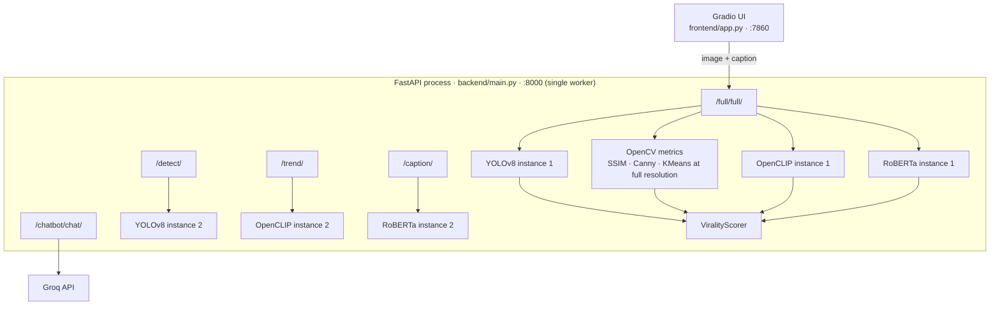

# ViraLens — AI Visual Intelligence for Social Media

ViraLens estimates how well an image + caption combination is likely to perform on
social media. It combines computer vision, aesthetics, trend similarity, and
caption analysis into a single explainable score.

> **Status:** working prototype. The score is a heuristic estimate, not a
> validated prediction of real engagement. See
> [`docs/IMPROVEMENTS.md`](docs/IMPROVEMENTS.md) for the calibration plan.

## 🚀 Key Features
- Image composition & geometry analysis (rule of thirds, symmetry, clutter)
- Color & lighting quality scoring
- Caption sentiment, hook, and CTA evaluation
- Trend similarity using CLIP embeddings
- Unified virality score with detailed breakdown
- Interactive Gradio-based UI for real-time analysis

## 🧠 Tech Stack
- **Backend:** FastAPI, OpenCV, PyTorch, YOLOv8, CLIP
- **NLP:** Transformer-based sentiment & caption analysis
- **Frontend:** Gradio
- **Image Gen (experimental):** Pollinations.ai
- **Deployment:** containerization and Hugging Face Spaces support are not
  implemented yet (see [`docs/IMPROVEMENTS.md`](docs/IMPROVEMENTS.md))

## 🏗 Architecture

ViraLens runs as two processes: a FastAPI backend on port 8000 and a Gradio
frontend on port 7860. Every model is loaded into the API process at import time.



The duplicate instances are real: `backend/routers/full_router.py` creates its own
detector, CLIP engine, and caption analyzer, while `detect_router.py`,
`trend_router.py`, and `caption_router.py` each create another. Because
`backend/main.py` imports all routers, the API loads YOLOv8, OpenCLIP, and RoBERTa
**twice** at startup. Fixing this is the first item in the architecture roadmap.

A `/full/full/` request roughly does the following:

1. Read the whole upload into memory and write it to `tmp_*.webp` in the
   current working directory.
2. Decode it with OpenCV.
3. Decode it again inside YOLOv8.
4. Run SSIM, Canny, and KMeans at the original resolution.
5. Decode it a third time for CLIP trend similarity.
6. Run caption sentiment with RoBERTa.
7. Combine the signals with `ViralityScorer` and return JSON.

Full details, measured timings, and the proposed target architecture are in
[`docs/ARCHITECTURE.md`](docs/ARCHITECTURE.md).

## 📁 Project Structure

```text
Viralens_studio/
├── backend/
│   ├── main.py              # FastAPI app entry point
│   ├── routers/             # /detect, /caption, /trend, /virality, /full, /chatbot
│   ├── models/              # Pydantic request/response schemas
│   ├── chat/                # Groq-backed chat engine
│   └── image_gen/           # Experimental image generation endpoint
├── cv_engine/               # Geometry, color, aesthetic, YOLO detection, CLIP trend matching
│   └── viral_bank/          # CLIP embeddings used as the trend reference bank
├── text_engine/             # Caption sentiment/hook/CTA scoring
├── scoring/                 # Virality score aggregation
├── frontend/app.py          # Gradio UI
├── scripts/                 # Developer utilities (latency benchmark)
├── tests/                   # Manual verification scripts
└── yolov8n.pt               # YOLOv8 weights used by the detector
```

## 🧰 Prerequisites

- **Python 3.10+** (the Pydantic schemas use `X | None` syntax)
- **pip** and **venv**
- ~2 GB of free disk space for PyTorch, Transformers, and model weights
- Internet access on the first run: the caption model
  (`cardiffnlp/twitter-roberta-base-sentiment-latest`) and the CLIP weights are
  downloaded from Hugging Face, and `yolov8n.pt` is loaded from the repo root
- No GPU is required. All engines fall back to CPU.

> **Important:** run every command from the **repository root**. The backend uses
> imports such as `backend.routers...` and loads `yolov8n.pt` /
> `cv_engine/viral_bank/` using paths relative to the current working directory.

## ⚙️ Setup

### 1. Clone and create a virtual environment

```bash
git clone https://github.com/Sravanjangam/Viralens_studio.git
cd Viralens_studio

python3 -m venv .venv
source .venv/bin/activate        # Windows: .venv\Scripts\activate
```

### 2. Install dependencies

```bash
pip install --upgrade pip
pip install -r requirements.txt
```

The OpenAI CLIP package is only needed by `cv_engine/aesthetic.py` and
`tests/test_aesthetic.py` (the API currently uses a lightweight
brightness/contrast "aesthetic" score instead):

```bash
pip install git+https://github.com/openai/CLIP.git
```

### 3. Configure environment variables

```bash
cp .env.example .env
```

Then edit `.env`:

| Variable | Required | Purpose |
| --- | --- | --- |
| `GROQ_API_KEY` | **Yes** | Powers `backend/chat/chat_engine.py`. The chat engine is instantiated while the API is importing, so the backend fails to boot without this key. Create one at <https://console.groq.com/keys>. |
| `GEMINI_API_KEY` | No | Only used by the standalone `test_gemini.py` script (requires `pip install google-genai`). |

`backend/main.py` calls `load_dotenv()`, which reads `.env` from the directory you
launch the server in — keep the file at the repository root.

## ▶️ Run Locally

The backend and frontend run as two separate processes. Use two terminals, both
started from the repository root with the virtual environment activated.

### Terminal 1 — Backend (FastAPI, port 8000)

```bash
uvicorn backend.main:app --reload --port 8000
```

- API root: <http://localhost:8000/>
- Interactive docs: <http://localhost:8000/docs>

Do **not** `cd backend` and run `uvicorn main:app`; the package imports and the
`yolov8n.pt` path assume the repository root is the working directory.

### Terminal 2 — Frontend (Gradio, port 7860)

```bash
python frontend/app.py
```

Open <http://localhost:7860> in your browser. The UI calls the backend at
`http://localhost:8000` (hard-coded in `frontend/app.py`), so start the backend
first.

### Verify the backend is up

```bash
curl http://localhost:8000/
# {"message":"ViraLens API Running 🚀"}
```

## 🔌 API Endpoints

All routes are also documented interactively at `/docs`.

| Method | Path | Description |
| --- | --- | --- |
| `GET` | `/` | Health check |
| `POST` | `/detect/` | YOLOv8 object detection on an uploaded image |
| `POST` | `/caption/` | Caption sentiment/hook/CTA/emoji scoring |
| `POST` | `/trend/` | CLIP trend similarity against the viral bank |
| `POST` | `/virality/` | Virality score from pre-computed metrics |
| `POST` | `/full/full/` | End-to-end analysis (detection + geometry + color + trend + caption + virality) |
| `POST` | `/chatbot/chat/` | Groq-backed explanation of the latest analysis |
| `POST` | `/image/improve/` | Experimental image-improvement prompt + generated images |

## ⚡ Performance

The current `/full/full/` path does all computer-vision work at the uploaded
image's full resolution. That is the dominant cost, and phone photos are usually
12 MP or larger.

Measured on an Apple M5 (10 cores, 24 GB), Python 3.14, OpenCV 5.0, using
synthetic images. YOLO, CLIP, and RoBERTa are **not** included in these numbers.

| Input | SSIM | Canny | KMeans | CV total |
| --- | ---: | ---: | ---: | ---: |
| 1280×720 (0.9 MP) | 24 ms | 2 ms | 1459 ms | **1.48 s** |
| 1920×1080 (2.1 MP) | 61 ms | 3 ms | 2206 ms | **2.27 s** |
| 3840×2160 (8.3 MP) | 252 ms | 10 ms | 8696 ms | **8.96 s** |
| 4K downscaled to 1024 px long edge | 23 ms | 1 ms | 314 ms | **0.34 s** |

KMeans color extraction accounts for 93–98% of the time. Downscaling to a 1024 px
long edge makes the same pipeline ~26× faster, with no meaningful loss for
composition/color heuristics. Reproduce with:

```bash
python scripts/bench_cv_pipeline.py
```

The fastest wins, in order:

1. Downscale once before all CV work (measured above).
2. Reuse a single instance of each model instead of loading it twice.
3. Run blocking inference off the event loop, and cache results by image hash.

More detail and the target architecture: [`docs/ARCHITECTURE.md`](docs/ARCHITECTURE.md).

## 🧪 Tests

The files in `tests/` are **manual verification scripts**, not an automated test
suite. They print their results and contain no assertions; some of them download
sample images from the internet. Because they import the `backend`, `cv_engine`,
`scoring`, and `text_engine` packages, run them from the repository root with the
root on `PYTHONPATH`:

```bash
PYTHONPATH=. python tests/test_virality_score.py
PYTHONPATH=. python tests/test_caption_analysis.py
PYTHONPATH=. python tests/test_yolo.py
```

An assertion-based unit test suite for the scoring layer is proposed in PR #2.

## 🩺 Troubleshooting

- **`ModuleNotFoundError: No module named 'backend'`** — you are running the
  server from inside `backend/`. Run `uvicorn backend.main:app --reload` from the
  repository root instead.
- **Backend exits with `GROQ_API_KEY environment variable is missing`** — create
  `.env` from `.env.example` and set `GROQ_API_KEY`.
- **`Form data requires "python-multipart"`** — install the dependencies from
  `requirements.txt`; `python-multipart` is required by the upload endpoints.
- **First request is very slow** — YOLO, RoBERTa, and CLIP weights are being
  downloaded/loaded for the first time. Subsequent requests reuse the loaded
  models.
- **`Address already in use`** — stop the process on port 8000/7860, or pass a
  different port (`--port 8001`) and update `BACKEND_URL` in `frontend/app.py` to
  match.
- **Frontend shows `Backend connection error`** — the FastAPI server is not
  running on port 8000 yet.

## 🗺 Roadmap

- [`docs/ARCHITECTURE.md`](docs/ARCHITECTURE.md) — current request flow, measured
  latency, bottlenecks, target architecture, and a phased migration plan.
- [`docs/IMPROVEMENTS.md`](docs/IMPROVEMENTS.md) — assessment method, prioritised
  engineering and product findings with evidence, trade-offs, and next actions.

## 📄 License

MIT — see [LICENSE](LICENSE).
