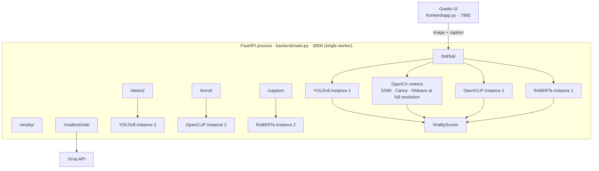
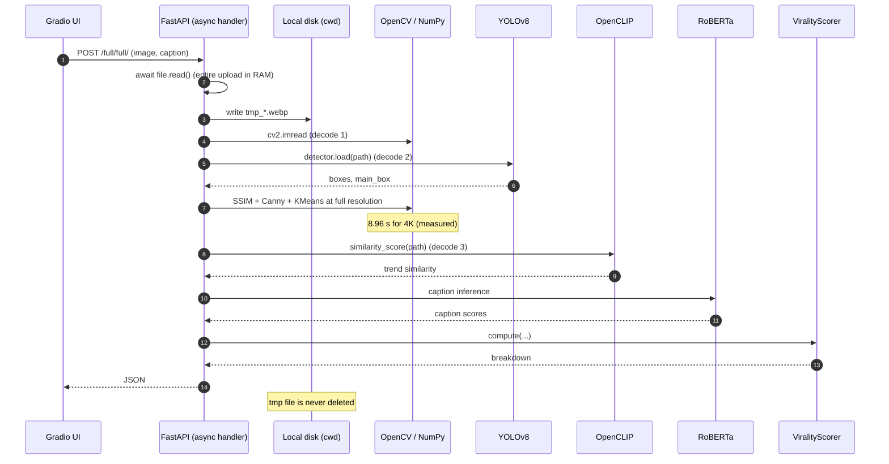
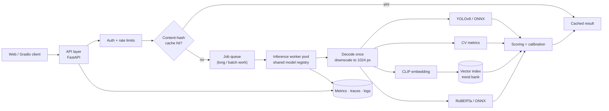

# Architecture, Latency, and Scaling Notes

This document describes what ViraLens does today, where the time goes, and how to
evolve the prototype into a service that stays fast under real usage.

Everything below is based on the code in this repository. Timings marked
**measured** were produced by `scripts/bench_cv_pipeline.py`; timings marked
**estimate** are planning targets for the model stages that were not benchmarked.

## 1. Current topology



Two processes, no shared state, no cache, no queue. All inference runs inside the
API process.

### Model instance count at startup

| Model | Loaded by | Instances |
| --- | --- | ---: |
| YOLOv8n | `full_router.py`, `detect_router.py` | 2 |
| OpenCLIP ViT-B/32 | `full_router.py`, `trend_router.py` | 2 |
| RoBERTa sentiment | `full_router.py`, `caption_router.py` | 2 |
| Groq client | `chat_router.py` | 1 |

`backend/main.py` imports every router, so all of these are constructed at import
time. On a cold start this doubles the download/load work for the three heaviest
models and keeps duplicate weights resident for the lifetime of the process.
`backend/routers/full_router.py:21-24` is the direct cause.

The chat client is also constructed at import time and raises if `GROQ_API_KEY`
is missing (`backend/chat/chat_engine.py:8-10`). That makes an optional feature a
hard startup dependency for the whole API.

## 2. Lifecycle of `/full/full/`



Observations from the code:

- The upload is buffered in memory and written to a predictable location in the
  working directory (`full_router.py`).
- The same file is decoded three times: OpenCV, YOLO (path input), and CLIP
  (PIL input).
- The CV stage runs on the original resolution.
- The handler is `async def` but calls blocking CPU code directly, so it occupies
  the event loop for the full duration.
- The temporary file is never removed.

## 3. Measured latency

Environment: Apple M5, 10 cores, 24 GB RAM, macOS, Python 3.14.2, OpenCV 5.0.0.
Input: synthetic Gaussian-blurred noise at the stated resolution. Excludes YOLO,
CLIP, RoBERTa, upload transfer, and JSON serialization.

| Input | SSIM | Canny | KMeans | CV total |
| --- | ---: | ---: | ---: | ---: |
| 1280×720 (0.92 MP) | 23.8 ms | 1.6 ms | 1458.7 ms | **1484.2 ms** |
| 1920×1080 (2.07 MP) | 60.6 ms | 3.4 ms | 2206.3 ms | **2270.2 ms** |
| 3840×2160 (8.29 MP) | 251.5 ms | 9.5 ms | 8695.8 ms | **8956.8 ms** |
| 4K downscaled to 1024×576 | 23.3 ms | 0.6 ms | 313.8 ms | **337.6 ms** |

KMeans (`cv_engine/color.py`) fits 10 cluster initialisations over every pixel.
It is 93–98% of CV time. A 1024 px long edge makes the pipeline **~26× faster**
with no meaningful change for composition and lighting heuristics.

These numbers are not a full request benchmark. They are enough to show that
resolution, not model choice, is the first thing to fix.

## 4. Bottlenecks

### B1 — Full-resolution computer vision

**Evidence:** table above; `cv_engine/color.py` reshapes the entire image and runs
KMeans; `cv_engine/geometry.py` computes SSIM and Canny at native resolution.

**Impact:** a 12 MP phone photo spends ~9 s in CV alone before any model runs.

**Fix:** decode once, resize so the long edge is ≤1024 px, run all CV metrics on
the resized array. For KMeans, additionally sample ≤50k pixels or use
`MiniBatchKMeans`.

**Expected:** CV stage from ~9 s to ~0.1–0.3 s on the same hardware.

### B2 — Duplicate model instances

**Evidence:** instance table above.

**Impact:** roughly doubles model load time and memory; makes `--workers N`
unaffordable because each worker would load up to six model copies.

**Fix:** one registry module (for example `backend/engines.py`) that constructs
each model once and is initialised in the FastAPI lifespan. Routers depend on the
registry instead of creating engines.

**Expected:** faster cold start, lower RSS, a viable path to multiple workers.

### B3 — Blocking inference on the event loop

**Evidence:** `full_router.py`, `detect_router.py`, `trend_router.py`, and
`caption_router.py` are `async def` but call synchronous CPU/IO code.

**Impact:** one long analysis blocks all concurrent requests in the process.

**Fix:** make CPU-only endpoints synchronous `def` (FastAPI runs them in a
threadpool), or wrap inference in `run_in_threadpool`. Keep genuinely async work
(socket IO) async. If throughput matters, move inference to dedicated workers.

### B4 — Three decodes and a disk round-trip

**Evidence:** OpenCV decode, YOLO path input, CLIP `Image.open(path)`.

**Impact:** extra CPU and IO on every request; prevents in-memory reuse of the
resized image.

**Fix:** decode once, keep a BGR NumPy array, pass it to Ultralytics directly,
convert to RGB once for CLIP, and drop the temporary file entirely.

### B5 — Temporary files are never deleted

**Evidence:** `full_router.py`, `detect_router.py`, `trend_router.py`, and
`image_router.py` write `tmp_*` / `temp_*` files and never remove them; the
pattern is hidden by `.gitignore`.

**Impact:** unbounded disk growth in the deployment environment.

**Fix:** `try/finally` cleanup, `tempfile.TemporaryDirectory`, or in-memory
buffers.

### B6 — No result cache

**Evidence:** every request recomputes all signals; the UI encourages repeated
experiments on the same image.

**Impact:** demo and iteration latency is paid repeatedly.

**Fix:** cache on `sha256(image_bytes)` for vision-only results, and on
`sha256(image) + caption` for the full result. Use an in-process LRU first, Redis
if the service is multi-instance. Include model version and weights version in
the key.

### B7 — Cold start and no warmup

**Evidence:** models are loaded at import; the first inference per process pays
additional lazy initialisation. There is no readiness signal.

**Impact:** the first user after a deploy/restart sees the worst latency, and the
health check says "up" before models are usable.

**Fix:** load models in a lifespan handler, run one tiny warmup inference per
model, and expose `/health/live` and `/health/ready`.

### B8 — No observability

**Evidence:** no request IDs, timing logs, metrics, or traces.

**Impact:** latency regressions cannot be attributed to a stage; the numbers in
this document had to be measured with a separate script.

**Fix:** middleware with request ID + total duration, per-stage timers around
decode/YOLO/CV/CLIP/NLP/scoring, Prometheus counters/histograms, structured logs.
Log sizes and timings, not captions or images by default.

### B9 — API and models share one process

**Evidence:** engine construction lives in router modules.

**Impact:** scaling the API scales the models; memory and CPU are coupled; a
single model bug takes down the API.

**Fix (later):** extract an inference service/worker pool that owns models, with
the API handling validation, caching, and job orchestration. This also enables
batching on GPU. For CPU-only deployments, one process with a threadpool is
simpler than many workers that each load duplicate weights.

### B10 — Synchronous UX

**Evidence:** `frontend/app.py` calls `requests.post(..., timeout=180)` and shows
a single status line.

**Impact:** a slow request looks like a hang; there is no progress or
cancellation.

**Fix:** show per-stage progress (`gr.Progress`) for the fast path; for large
images or batch work, submit a job and poll/stream results. Always keep the
backend timeout below the client timeout.

### B11 — Unbounded uploads

**Evidence:** no size, MIME, or pixel-dimension validation; the client-supplied
file extension is interpolated into a filesystem path in `detect_router.py` and
`trend_router.py`.

**Impact:** memory/CPU exhaustion and path-handling risk.

**Fix:** cap bytes (for example 10 MB), allowlist MIME types, check decoded pixel
count before running models, and never build paths from client filenames. See
`docs/IMPROVEMENTS.md` for the security checklist.

## 5. Target architecture



Principles:

1. **Decode once, downscale once.** All consumers share the processed image.
2. **One copy of each model.** Owned by the worker/registry, not by routers.
3. **Fast path stays synchronous; slow path becomes a job.** A single 1080p image
   should return in under ~2 s; batch/large inputs get a job ID.
4. **Cache before compute.** Vision results keyed by image hash; full results
   keyed by image + caption + model versions.
5. **Expose where time went.** Per-stage timings in every response header/log.

## 6. Latency budget

Targets for one image up to 12 MP on 4 CPU cores, after the Phase 0/1 work:

| Stage | Target p50 | Notes |
| --- | ---: | --- |
| Upload + validation | 20–50 ms | Reject oversized input early |
| Decode + downscale | 30–80 ms | One decode, 1024 px long edge |
| YOLOv8 (ONNX/int8) | 60–150 ms | CPU; more on shared runners |
| CV metrics at 1024 px | 100–300 ms | KMeans is the tail; sample pixels |
| CLIP embedding | 40–120 ms | Optional for `/full` if trend is cached |
| RoBERTa caption | 60–150 ms | CPU |
| Scoring | <1 ms | Pure arithmetic |
| **Total** | **0.4–0.8 s** | p95 target < 2 s |

These are engineering targets, not measurements. The only measured stage today is
CV, and it already misses the target by ~26× at 4K.

## 7. Migration plan

### Phase 0 — Quick wins (hours to 1 day)

1. Add a shared preprocessing function: decode once, downscale to 1024 px, return
   a single BGR array.
2. Pass the array to YOLO and to CLIP (RGB conversion only at the boundary).
3. Create `backend/engines.py`, initialise each model once in the app lifespan,
   and update routers to use it.
4. Remove duplicate engine instances from `full_router.py`.
5. Make CPU endpoints synchronous `def` or use `run_in_threadpool`.
6. Replace temp files with in-memory buffers; delete any remaining files in
   `finally`.
7. Make `ChatEngine` lazy so `GROQ_API_KEY` is only required for `/chatbot`.
8. Add per-stage timing logs.

Expected: 4K CV from ~9 s to ~0.3 s; startup and memory roughly halved for the
model set; concurrent requests no longer serialize.

### Phase 1 — Week 1–2

- Content-hash cache (LRU → Redis when multi-instance).
- Upload validation: byte limit, MIME allowlist, pixel limit, extension
  allowlist.
- Declare `response_model` for `/full/full/` and align
  `backend/models/full_model.py` with the actual payload.
- Warmup + `/health/ready`.
- ONNX Runtime or OpenVINO for YOLO/CLIP/RoBERTa; int8 where accuracy allows.
- CI: unit tests, lint, a small contract test for the API, benchmark smoke test.

### Phase 2 — Week 3–6

- Extract an inference worker; API validates and enqueues.
- Vector index for the trend bank (FAISS or pgvector), with bank versioning.
- Metrics, traces, dashboards, and an SLO alert on p95.
- Container image and a real deployment target (HF Spaces, Fly.io, Cloud Run).

### Phase 3 — Product scale

- Platform/niche-specific scoring and calibration.
- Batch analysis and A/B comparison.
- GPU worker pool only if measured demand justifies it.

## 8. Reproduce the measurements

```bash
python scripts/bench_cv_pipeline.py
```

The script uses synthetic images and excludes model inference. Run it on the
target deployment hardware before committing to a latency SLO.
